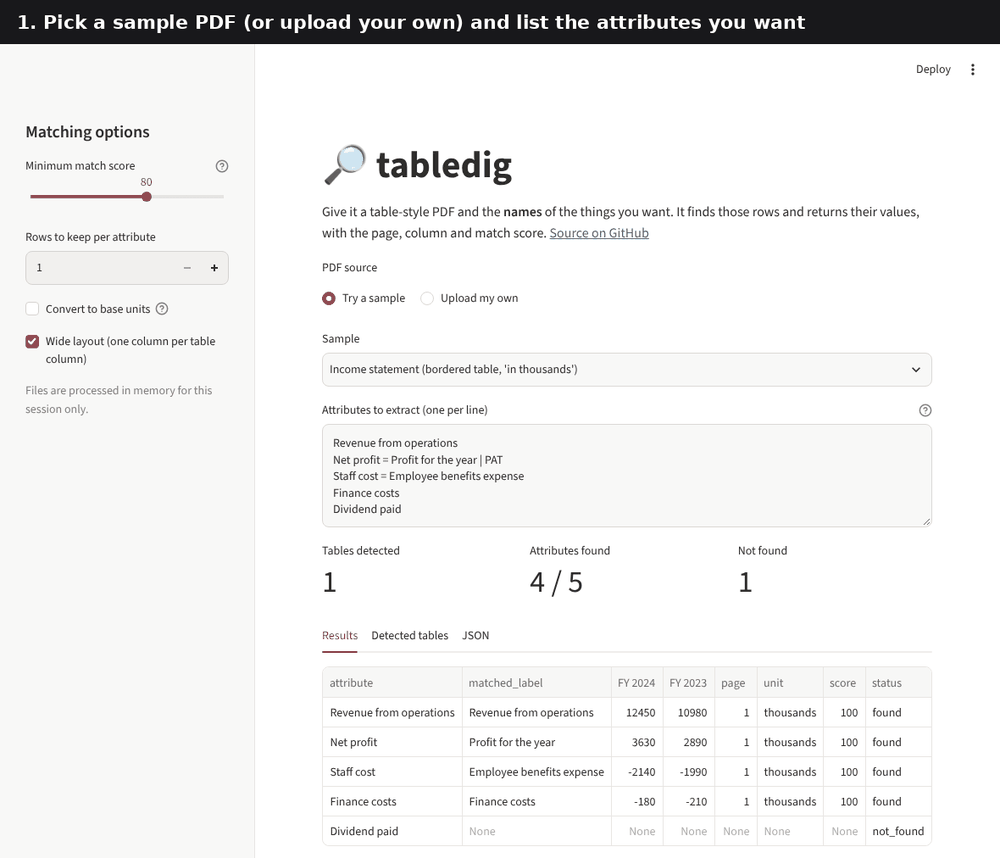

# tabledig

[](https://github.com/Perarulalanloganathan/tabledig/actions/workflows/ci.yml)

[](https://tabledig.streamlit.app)
[](LICENSE)

Give it a PDF and the names of the things you want. Get back their values.

`tabledig` finds tables in table-style PDFs (financial statements, invoices, reports,
price lists, lab results...) and looks up **named attributes** - row labels such as
*"Total revenue"* or *"Subtotal"* - returning every value on that row, with the column it
came from, the page, and how confident the match was.



*The [live demo](https://tabledig.streamlit.app) in action.*

```text
$ tabledig extract examples/sample_income_statement.pdf \
      --attr "Revenue from operations" --attr "Net profit" --attr "Dividend paid" --wide

file,attribute,matched_label,page,unit,score,status,FY 2024,FY 2023
sample_income_statement.pdf,Revenue from operations,Revenue from operations,1,thousands,100.0,found,12450.0,10980.0
sample_income_statement.pdf,Net profit,,,,,not_found,,
sample_income_statement.pdf,Dividend paid,,,,,not_found,,
```

"Net profit" is *not* found there because the document says "Profit for the year".
Tell the tool that once with an alias and it is found:

```yaml
- name: Net profit
  aliases: [Profit for the year, Profit after tax, PAT]
```

## Try it in the browser

**Live demo: https://tabledig.streamlit.app** (no install needed).

A Streamlit app lets you upload a PDF (or pick a sample), list the attributes you want, and see
the results, every detected table, and a CSV download:

```bash
pip install -e ".[app]"
streamlit run app/streamlit_app.py
```

## Why it is useful

- **Any table-style PDF.** Not tied to one country, form or taxonomy.
- **Ask in your own words.** Exact, "contains" and typo-tolerant fuzzy matching, plus aliases.
- **Bordered or borderless tables.** Uses drawn grid lines when present and falls back to
  whitespace-aligned text rows when not.
- **Numbers done right.** `(1,200)` is negative, `12,34,567` (Indian grouping) works, dashes are
  zero, currency symbols and `%` are stripped, and a "Note" column is not mistaken for data.
- **Units.** Detects "in thousands / lakhs / crores / millions / billions" and can convert to base units.
- **Explainable.** Every value carries the matched label, page, score and method, so you can audit it.
- **Batch friendly.** Folders of PDFs, parallel workers, and one broken file never stops the run.

## Install

```bash
pip install git+https://github.com/Perarulalanloganathan/tabledig.git
# with .xlsx output and DataFrame support:
pip install "tabledig[excel] @ git+https://github.com/Perarulalanloganathan/tabledig.git"
```

From source:

```bash
git clone https://github.com/Perarulalanloganathan/tabledig.git
cd tabledig
pip install -e ".[dev]"
```

## Quick start

### 1. See what is in the PDF

```bash
tabledig inspect report.pdf
```

Prints each detected table (page, header, first rows, declared unit) so you can pick the
labels to ask for.

### 2. Extract

```bash
tabledig extract report.pdf --attr "Total revenue" --attr "Net profit" -o result.csv
tabledig extract ./reports/ -a attributes.yaml -o result.xlsx --wide -j 4
```

Output is **long format** by default (one row per attribute x column). `--wide` gives one row
per attribute with a column per table column (e.g. one per year).

Aliases can go inline: `--attr "Net profit=Profit for the year|PAT"`.

### 3. Or use it from Python

```python
from tabledig import extract, to_dataframe

records = extract("report.pdf", ["Total revenue", {"name": "Net profit", "aliases": ["PAT"]}])
df = to_dataframe(records, wide=True)      # needs tabledig[excel]
```

## Attribute files

YAML (also `.json` and `.csv`):

```yaml
min_score: 80            # default minimum match score, 0-100
top_k: 1                 # best-matching rows kept per attribute and file
normalize_units: false   # true -> convert thousands/lakhs/millions to base units

attributes:
  - Total revenue                      # plain string = fuzzy match
  - name: Revenue from operations
    mode: exact                        # exact | contains | fuzzy
  - name: Staff cost
    aliases: [Employee benefits expense, Salaries and wages]
```

CSV needs an `attribute` column and may add `aliases` (separated by `|`), `mode`, `min_score`.

### Match modes

| mode | matches when | use it for |
| --- | --- | --- |
| `exact` | label is identical after lower-casing and stripping punctuation/numbering | precise control |
| `contains` | your words appear, in order, inside the label | "tax" -> "Tax expense" |
| `fuzzy` (default) | word overlap blended with character similarity | typos, word order, plural/singular |

When several rows match, the highest score wins; ties go to the shorter, more specific label.

## Output columns

`file, attribute, status, matched_label, page, column, raw_value, value, unit, score, method, source, note`

- `status`: `found`, `not_found`, or `error` (unreadable PDF; the message is in `note`)
- `value`: parsed number; `raw_value`: the cell text as printed
- `unit`: unit declared on the page (`thousands`, `lakhs`, ...) or `base` after `--normalize-units`
- `source`: `ruled` (grid lines) or `text` (whitespace-aligned)

## Benchmark (synthetic)

`benchmarks/run_benchmark.py` generates a seeded corpus of fictional PDFs - bordered statements,
borderless statements and invoices, with units, negative formats, Indian number grouping, a "Note"
column, look-alike distractor rows and typos in 25% of labels - and scores value-level precision and
recall against known answers.

```bash
python benchmarks/run_benchmark.py --n 60 --seed 7
```

| Queries | Docs | Precision | Recall |
| --- | ---: | ---: | ---: |
| name only (`"Net profit"`) | 60 | 81.8% | 35.0% |
| with aliases (`"Net profit"` + the wordings you expect) | 60 | 100.0% | 100.0% |

How to read it:

- **Synthetic, so optimistic.** It tests controlled layout, wording and typo variation. It is *not* a
  claim about accuracy on arbitrary real-world PDFs.
- **Aliases matter.** Matching is lexical, so "Net profit" cannot find "Profit for the year" on its own.
  Name-only recall is low for exactly that reason; listing the wordings fixes it.
- **Short generic names are risky.** Most name-only false positives come from the one-word query "Tax"
  matching "Tax paid" or "Profit before tax". Use longer names, aliases or `mode: exact` for those.
- A smaller version of this benchmark runs in the test suite as a regression guard.

## How it works

```
PDF --pdfplumber--> tables (ruled -> text fallback) --> header + unit detection
                                   |
 attributes --> score each row label (exact / contains / fuzzy + aliases)
                                   |
                best row(s) --> parse numbers --> records --> CSV / JSON / XLSX / DataFrame
```

Source layout: `reader.py` (tables), `matcher.py` (scoring), `normalize.py` (numbers, units),
`extractor.py` (engine), `config.py` (attribute files), `output.py`, `cli.py`; `app/` holds the
Streamlit demo and `benchmarks/` the benchmark.

## Tested beyond finance

The extractor is not tied to financial statements. Besides the synthetic benchmark, it was spot-checked
against public third-party PDFs (FBI firearm background-check tables, a California WARN layoff report,
a Chinese-language land-use standard): values were compared with the printed numbers and matched,
including a 22-column table and a multi-page table whose header appears only on page 1. The test suite also
builds prose-plus-table documents (lab results, sales by region, price lists, German-format statements) and
checks that numbers written in the narrative are never returned. Those third-party PDFs are not included
in this repository.

## Limitations

- Needs a text layer. **Scanned PDFs need OCR first** (e.g. `ocrmypdf`); built-in OCR is on the roadmap.
- Borderless tables without a year-style header get generic column names (`col_2`, `col_3`...).
- Wrapped row labels that span two lines are not joined yet.
- PDFs whose text layer has no spaces between words (some government exports) cannot be matched by label.
- Matching is lexical; it will not know that "turnover" means "revenue" unless you add an alias.

## Roadmap

- [ ] Optional embedding / LLM matcher for synonyms with confidence scores
- [ ] OCR for scanned pages
- [ ] Column detection from word positions for borderless tables
- [x] Web demo (Streamlit)
- [x] Synthetic benchmark
- [ ] Benchmark on labeled real public filings (SEC / Companies House)
- [x] Hosted public demo: https://tabledig.streamlit.app

## Development

```bash
pip install -e ".[dev,excel]"
python examples/make_sample_pdfs.py   # regenerate the fictional sample PDFs
pytest
ruff check .
```

The sample PDFs are generated from fictional data; the project ships no real company data.

## License

MIT - see [LICENSE](LICENSE).
